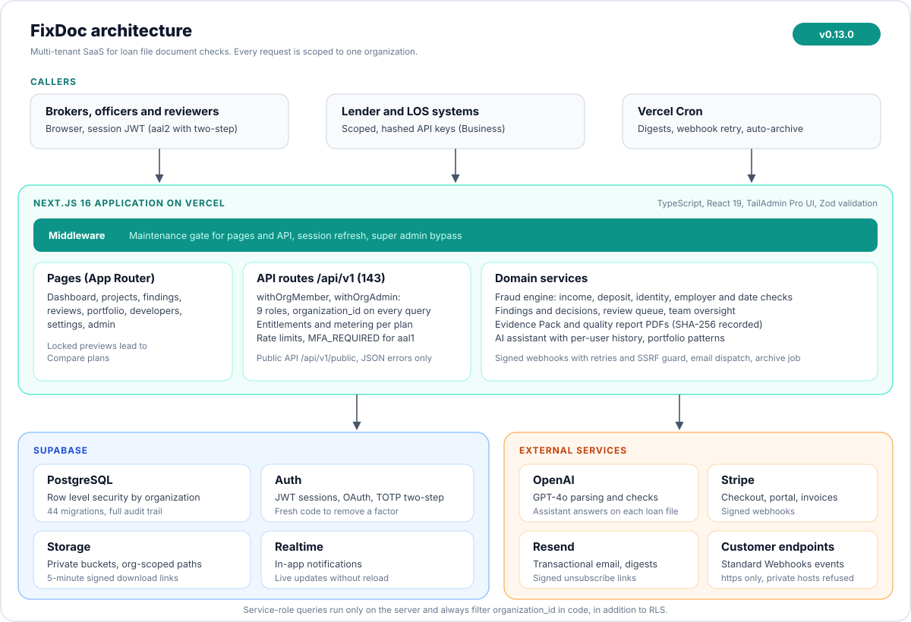
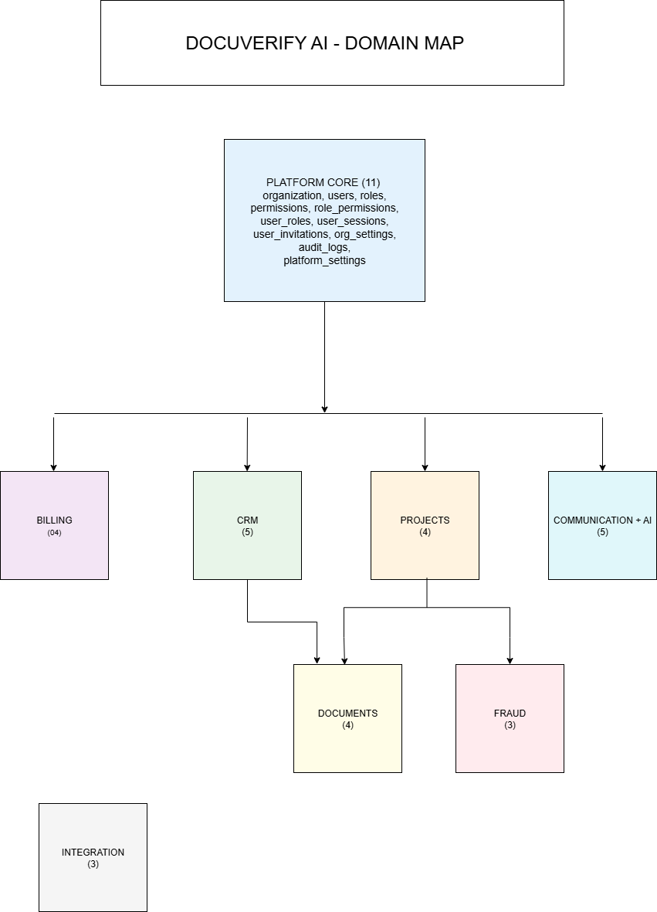

<p align="center">
  
</p>

<h1 align="center">FixDoc: Document Checks for Mortgage Loan Files</h1>

[](#)
[](https://nextjs.org/)
[](https://react.dev/)
[](https://www.typescriptlang.org/)
[](https://tailwindcss.com/)
[](https://supabase.com/)
[](https://stripe.com/)
[](https://openai.com/)
[](#)
[](#)
[](LICENSE)

---

> **This is a product showcase repository.** It contains documentation, architecture, and feature overviews for FixDoc, a proprietary multi-tenant SaaS platform developed by [ByteUp LLC](https://byteup.co). The source code is not included. FixDoc runs at [fixdoc.co](https://fixdoc.co) and is in private beta. For demos or licensing inquiries, see [Licensing](#licensing) below.

## About

**FixDoc** runs document checks on mortgage loan files. It is built for brokers who have to show their work.

FixDoc reads the pay stubs, W-2s, 1099s and bank statements in a loan file. It checks them against each other and against the borrower, and turns every mismatch into a finding that a reviewer decides and documents. The result is a review record a lender or examiner can read: an Evidence Pack per file, a quarterly quality report, and an audit trail of every decision.

FixDoc does not verify documents or make credit decisions. **Its findings are inconsistencies to review, never verification.** A qualified underwriter makes every decision using the full file, and a unit test blocks overstated claims (such as "verified income" or "fraud detected") on every page a reader sees.

FixDoc has been multi-tenant from day one. PostgreSQL Row Level Security isolates every row by organization, and every route also filters by the caller's organization in code. Every API request is checked against a nine-role permission table, and every plan feature is checked on the server.

FixDoc is at **v1.0.0-rc.1 (release candidate)** and in private beta, on the way to the v1.0.0 production release.

## Key Features

### Multi-Tenant Platform Core

- **Organization isolation in two layers**: Row Level Security on every table, plus an `organization_id` filter in every route, including server-side service-role queries
- **Nine roles**: super admin, owner, admin, manager, officer, agent, member (processor), viewer (quality control) and applicant. Each role can do what its job needs and nothing more. Permissions come from one server-side table and anything not allowed is denied.
- **Team management**: member invitations, onboarding, and a Team tab per loan file (processor, underwriter, closer, assistant, quality control, borrower)
- **Optional file access by team**: owners can limit officers, agents and viewers to the files they work on
- **Audit logging**: every sensitive action is recorded with ids only, never borrower names

### CRM & Loan Files

- Client profiles: contacts, addresses, employment history, assets
- Loan files with a status workflow and team assignments
- Finished files (closed, denied, cancelled) can be archived and restored, and archiving never deletes anything. Vercel Cron archives stale files automatically.
- A document can be removed from a file without erasing it. It stays under its retention period, and an owner or admin can restore it.

### Document Management

- Document vault by category, with storage counted against the plan limit
- Private Supabase Storage buckets with **5-minute signed download links**; every download is audited
- Scanned PDFs and phone photos are read by **OCR on FixDoc's own servers** and marked "Read from a scan". No image is ever sent to the AI.
- SSNs are removed and account numbers masked before any document text reaches the AI. SSNs, EINs and TINs are stored as their last 4 digits.

### Document Checks and Findings

The checks are FixDoc's core. AI only reads the documents. The findings come from calculations a reviewer can follow.

- **Income, deposit, name, employer and date checks**: values shown side by side, with a "why this score" breakdown
- **Tampering checks without AI**: statement balances that do not reconcile, pay stubs whose gross minus deductions is not net, year-to-date pay that does not progress, PDF metadata and edit history showing a file re-saved by other software, large or round deposits that need a source, and missing months or duplicate versions of a statement or pay period
- **W-2 and 1099 checks without AI**: Social Security and Medicare tax against payroll rates and the SSA wage base, EIN format, the W-2 against the year's final pay stub, current pay against last year, and the 1099 payer's TIN. A form the rules do not fit (a W-2c, an exempt employee) is listed as "Could not check", with the reason.
- **Check what we read**: the values read from each document are shown before the checks run. A misread value can be corrected with a reason, the original is kept, and every finding and the Evidence Pack show the correction.
- **Decisions**: each finding is marked Explained, Not an issue or On hold, with a required note and an append-only history. Decisions carry forward when a file is checked again.
- **Duplicate alerts** when the same document appears on another file
- **Evidence Pack PDF** per file: documents with their SHA-256 hashes, the checks run, findings and decisions. It is marked Outdated when newer work exists.

### Team Work (Team and Business plans)

- Review queue with claim, assign, due dates, a board and a calendar
- Team oversight: workload, overdue and unassigned reviews, time to clear
- AI assistant on each loan file, with a private conversation history per user
- Weekly review digest email

### Proof for Lenders (Business plan)

- Portfolio patterns across files (shared phone or email, identical pay stubs, repeated employers), masked
- Custom check thresholds within safe bounds, recorded on every analysis
- **Quarterly quality report PDF** and audit log export
- **Read-only public API** with scoped, hashed keys and **Standard Webhooks** events (signed, retried, https only)

### Billing & Subscriptions (Stripe)

- Plans: **Trial, Solo $99, Team $199, Business $399** a month (20% less yearly)
- Stripe Checkout and Customer Portal, owner only
- Locked features show a sample and link to a Compare plans page instead of an error
- Complimentary access for beta and support grants. It ends on its set date, owners and admins are emailed before it ends, and billing never starts early.
- A failed payment marks the plan Past due and emails the owners with the amount and the next retry date

### Notifications

- Real-time in-app notifications (Supabase Realtime)
- Email via **Resend** with signed unsubscribe links
- Daily and weekly digests, quiet hours and per-type preferences
- Internal notes on each file

### Scheduled Jobs (Vercel Cron)

- Daily and weekly email digests
- Weekly review digest
- Webhook delivery retry
- Loan file auto-archive
- Complimentary access reminders

## Architecture

<p align="center">
  
</p>

*The diagram was drawn at v0.13.0. The counts below are current.*

FixDoc has four layers. Browsers, lender systems and Vercel Cron call the Next.js application on Vercel. Its route handlers enforce role, tenant and plan checks and call the domain services. Those services use the Supabase platform (PostgreSQL, Storage, Auth, Realtime) and external services for AI, payments, email and customer webhooks.

```
+-------------------------------------------------------------+
|                         CALLERS                             |
|   Browsers (session, TOTP)  |  Lender systems (API keys)    |
|                      Vercel Cron                            |
+-------------------------------------------------------------+
                              |
                              v
+-------------------------------------------------------------+
|                       API LAYER                             |
|   Next.js route handlers (151, 146 under /api/v1)           |
|   Roles, organization scoping, plan entitlements, Zod       |
+-------------------------------------------------------------+
                              |
                              v
+-------------------------------------------------------------+
|                   SUPABASE PLATFORM                         |
|   Database (PostgreSQL + RLS) | Storage | Auth | Realtime   |
+-------------------------------------------------------------+
                              |
                              v
+-------------------------------------------------------------+
|                   EXTERNAL SERVICES                         |
|   OpenAI GPT-4o | Stripe | Resend | Customer webhook hosts  |
+-------------------------------------------------------------+
```

### Domain Overview

<p align="center">
  
</p>

FixDoc is organized into bounded domains: **Platform Core** (users, organizations, sessions), **CRM** (clients, contacts, addresses, employments, assets), **Projects** (loan files, assignments, status workflows), **Documents** (uploads, types, retention), **Document Checks** (analyses, findings, decisions, reviews), **Billing** (subscriptions, invoices, usage), **Communication & AI** (notifications, assistant conversations), and **Integration** (API keys, webhooks). Each domain has its own detailed ERD with column-level schema, available under NDA for licensing or pilot discussions.

### Why this stack

- **Next.js 16 (App Router)**: Server Components keep the client bundle small, and route handlers live next to the pages
- **Supabase (Postgres + RLS)**: multi-tenancy at the database layer as well as in the application, so one mistake in a route cannot expose another organization's data
- **Stripe**: subscription billing, webhooks, the customer portal and plan metadata all live in Stripe
- **OpenAI GPT-4o**: structured output for document parsing (predictable JSON) and the per-file assistant. It reads redacted text only, and the checks themselves are calculations.
- **OCR on own servers**: scans and photos are read without sending images to a third party
- **Resend**: a clean API, React Email templates and signed unsubscribe links

## Tech Stack

| Layer           | Technology                                                       |
| --------------- | ---------------------------------------------------------------- |
| Frontend        | Next.js 16, React 19, TypeScript 5 (strict), Tailwind CSS v4     |
| UI Library      | TailAdmin Pro (dashboard components), light and dark mode        |
| Backend         | Next.js route handlers (151, 146 under `/api/v1`)                |
| Database        | PostgreSQL (Supabase) with Row Level Security, 45 migrations     |
| Auth            | Supabase Auth: email and Google sign-in, TOTP two-step           |
| Storage         | Supabase Storage (private buckets, 5-minute signed links)        |
| Payments        | Stripe Checkout, Customer Portal, signed webhooks                |
| AI              | OpenAI GPT-4o and GPT-4o mini (document reading, assistant)      |
| OCR             | Server-side OCR for scanned PDFs and phone photos                |
| PDF             | Text extraction, plus generated Evidence Pack and quality report |
| Email           | Resend (transactional + digests)                                 |
| Jobs            | Vercel Cron                                                      |
| Validation      | Zod (schemas for every API endpoint)                             |
| Testing         | Vitest (unit), integration and load suites, live-test scripts, Playwright journeys |
| CI/CD           | GitHub Actions                                                   |
| Hosting         | Vercel                                                           |

## Engineering Highlights

### Multi-Tenancy Done Right

FixDoc enforces multi-tenancy at three layers:

1. **Database (RLS)**: every table has a Row Level Security policy keyed to `organization_id`.
2. **API (route wrappers)**: every request is authenticated, and the route checks the caller's role and filters every query by the caller's `organization_id`. The service-role queries that run on the server do this too. Routes never trust `org_id` from the URL or body.
3. **UI (role gating)**: screens hide the actions a role may not take. The server still refuses them with a plain reason.

A file outside someone's access answers Not found, so it does not reveal that the file exists.

### Document Check Design

The check engine is a service layer separate from the route handlers. AI reads redacted document text into structured values. Those values are shown to the user ("Check what we read") and can be corrected. Then deterministic checks compare documents with each other and with the client record. Each finding carries the expected and printed values, a severity and the next step a broker can take. A form a check cannot judge is listed with the reason instead of being guessed at.

Every analysis records the checks it ran, the thresholds it used and the version of the engine. Reviewers' decisions are stored append-only. The Evidence Pack records the SHA-256 hash of each document, so a lender can see exactly what was reviewed.

*Implementation details, service interfaces and the full check logic are available under NDA for pilot discussions or licensing inquiries.*

### Honest Claims, Enforced by Tests

FixDoc can only find inconsistencies, so its copy must not promise more. A list of banned claims ("verified income", "fraud detected", accuracy percentages, guarantees, "authentic") is checked by a unit test against every reader-facing surface in English and Spanish. A claim that slips in fails the build.

### Caching & Rate Limiting

Plan limits, usage counters and finished analyses are cached in an in-memory LRU cache, keyed by organization and resource and cleared on writes. Rate limiting uses a sliding window per organization, and higher plans get larger windows.

### Webhooks In and Out

Inbound Stripe webhooks are checked by signature and processed idempotently by event id. Events whose live or test mode differs from the key are ignored. Checkout and portal sessions only return to FixDoc addresses.

Outbound customer webhooks follow the Standard Webhooks spec. They are signed, sent over https only, refused for private addresses (SSRF guard) and retried on a schedule, with a delivery log.

### Document Security

- Documents are stored in **private, org-scoped buckets**
- Downloads use **signed URLs that expire after 5 minutes**, and every download is audited
- SHA-256 is recorded for every generated PDF
- Sensitive identifiers are redacted before AI processing and kept to their last 4 digits

## By the Numbers

| Metric                    | Value                                          |
| ------------------------- | ---------------------------------------------- |
| Route handlers            | 151 (146 under `/api/v1`)                      |
| Database Migrations       | 45 versioned SQL files                         |
| Roles                     | 9                                              |
| Subscription Plans        | Trial, Solo, Team, Business                    |
| Unit Tests                | **~3,723** (Vitest)                            |
| Test Coverage             | 70.5%                                          |
| Scheduled Jobs            | 5 (Vercel Cron)                                |
| Release Documents         | Versioned release specs (v0.1.0 → v1.0.0)      |

## Roadmap

There is a versioned release plan from v0.1.0 through v1.0.0, and each version has its own detailed scope document.

| Phase    | Versions             | Focus                          | Status       |
| -------- | -------------------- | ------------------------------ | ------------ |
| Phase 0  | v0.1.0 to v0.3.0      | Platform Foundation            | Complete     |
| Phase 1  | v0.4.0 to v0.9.0      | Core Features (MVP)            | Complete     |
| Phase 2  | v0.10.0 to v1.0.0     | Production Release             | In Progress (release candidate) |
| Phase 3  | v1.1.0+              | Enhancements                   | Pending      |
| Phase 4  | v2.0.0               | Insurance Expansion            | Pending      |

### Version progress

| Version     | Name                         | Status      |
| ----------- | ---------------------------- | ----------- |
| v0.1.0      | Authentication               | Complete    |
| v0.2.0      | Organizations                | Complete    |
| v0.3.0      | Admin Panels                 | Complete    |
| v0.4.0      | CRM                          | Complete    |
| v0.4.5      | Billing & Subscriptions      | Complete    |
| v0.5.0      | Projects                     | Complete    |
| v0.6.0      | Documents                    | Complete    |
| v0.7.0      | Document Check Engine        | Complete    |
| v0.8.0      | AI Assistant                 | Complete    |
| v0.9.0      | Real-Time & Notifications    | Complete    |
| v0.10.0     | Internal Notes               | Complete    |
| v0.11.0     | Polish & Beta-Ready          | Complete    |
| v0.12.0     | Testing, Docs & Pre-Beta     | Complete    |
| v0.13.0     | Tier Value Program           | Complete    |
| v1.0.0-rc.1 | Release Candidate            | In Progress (private beta) |
| v1.0.0      | Production Release           | Pending     |

## Security Posture

### Authentication

- Supabase Auth with email and Google sign-in
- **TOTP two-step verification** on every plan, enforced by the API for enrolled accounts. Removing a factor needs a fresh code.
- Owners and admins can reset a member's two-step verification down the role hierarchy, never their own
- Failed sign-ins lock the account for a period

### Authorization

- Nine roles checked on the server for every call from one permission table, deny by default
- Owners alone change billing. Members (processors) work files without creating them. Viewers (quality control) change nothing. Applicants see only their own file.
- Row Level Security on every table plus an organization filter in every route
- Plan features checked on the server by an entitlement resolver

### Data Protection

- TLS 1.2+ in transit, AES-256 at rest
- Private, organization-scoped storage with 5-minute signed links
- SSNs and account numbers redacted before AI processing
- Audit log for every sensitive action, with ids only

### API Security

- Every endpoint validates inputs with Zod schemas
- Rate limiting per organization, scaled by plan
- API keys stored as hashes, scoped and revocable
- Stripe webhooks checked by signature and deduplicated; outbound webhooks signed with an SSRF guard
- Consistent JSON error responses with error codes, no leaked stack traces

## CI/CD Pipeline

GitHub Actions pipeline with 5 stages:

1. **Quality**: ESLint and the TypeScript strict check
2. **Unit Tests**: ~3,723 Vitest tests
3. **Build**: Next.js production build plus bundle checks
4. **Integration**: API endpoint tests against a running app
5. **Load**: performance tests (main branch only)

All stages must pass before merging to `main`. On top of CI, live-test scripts drive the real API the way a person does, and Playwright journeys cover the main flows in a browser.

## Documentation Structure

FixDoc ships with extensive documentation, treated as a deliverable rather than an afterthought.

| Document                                | Purpose                                                    |
| --------------------------------------- | ---------------------------------------------------------- |
| `ROADMAP.md`                            | Versions and their status                                  |
| `CHANGELOG.md`                          | Every change, version by version                           |
| `product_requirements_document.md`      | Product vision, features, user stories                     |
| `technical_standards.md`                | NFRs, SLOs, security requirements, coding standards        |
| `frontend_technical_standards.md`       | Frontend patterns, testing conventions, component rules    |
| `entity_analysis.md`                    | Full database schema documentation                         |
| `rbac_permissions_matrix.md`            | Role-based access control matrix                           |
| `rls_policies.md`                       | Row Level Security policy documentation                    |
| `SECURITY_POLICY.md`                    | Security policy, including what is sent to AI             |
| `releases/v0.1.0.md` to `v1.0.0.md`      | Per-version scope, acceptance criteria, deliverables       |
| `api/`                                  | Public API reference and error codes                       |
| `runbooks/`                             | Launch, maintenance mode, support                          |
| User guide                              | English and Spanish PDFs built from real screenshots       |
| `diagrams/`                             | ERDs and architecture diagrams                             |

## Skills Demonstrated

| Area                     | Details                                                                          |
| ------------------------ | -------------------------------------------------------------------------------- |
| Multi-Tenant SaaS        | RLS plus per-route organization filtering, optional file access by team          |
| Full-Stack TypeScript    | Next.js 16 App Router, React 19, strict TS, 151 route handlers                   |
| Database Design          | 45 migrations, FK integrity, indexing, RLS policies, append-only histories       |
| RBAC                     | Nine roles, one server-side permission table, API + UI enforcement               |
| Payments Integration     | Stripe Checkout, Customer Portal, webhook dispatching, plan entitlements         |
| Document Analysis        | Deterministic tampering, W-2 and 1099 checks; OCR on own servers                 |
| AI Integration           | GPT-4o structured parsing on redacted text, per-file assistant                   |
| Public API               | Read-only API with hashed keys, Standard Webhooks with retries and SSRF guard    |
| Security                 | RLS, RBAC, TOTP two-step, signature checks, audit logging, signed URLs           |
| Testing                  | ~3,723 unit tests (70.5% coverage), integration, load, live scripts, Playwright  |
| DevOps                   | GitHub Actions CI, 5-stage pipeline, Vercel deployment and Cron                  |
| Documentation            | Release specs, NFRs, ERDs, API reference, bilingual user guide                   |

## About ByteUp

FixDoc is a product of **[ByteUp LLC](https://byteup.co)**, a software studio building SaaS products for underserved markets and delivering contract development for clients who value clean architecture and reliable code.

### ByteUp products

| Product                   | Status             | Link                                                                                        |
| ------------------------- | ------------------ | ------------------------------------------------------------------------------------------- |
| **FixDoc**                | Private beta       | You are here · [fixdoc.co](https://fixdoc.co)                                               |
| **Migratex**              | Production-ready   | [migratex-showcase](https://github.com/ivansing/migratex-showcase): Excel → PostgreSQL ETL CLI |
| **Stripe Payment Links**  | Production-ready   | [stripe-payment-links-showcase](https://github.com/ivansing/stripe-payment-links-showcase): FastAPI payment API |
| **TroveTrends**           | Live               | [trovetrends.com](https://trovetrends.com)                                                  |

### Author

Built and maintained by **Ivan Duarte**, Full-Stack Software Engineer and founder of ByteUp LLC. Based in Bogotá, Colombia.

- Company: [byteup.co](https://byteup.co) · contact@byteup.co
- GitHub: [@ivansing](https://github.com/ivansing)
- LinkedIn: [lance-dev](https://linkedin.com/in/lance-dev)

## Licensing

FixDoc is proprietary software developed by ByteUp LLC. The source code is not included in this repository and is not available under any open-source license. The application runs at [fixdoc.co](https://fixdoc.co) and is in private beta.

This repository contains documentation and marketing materials only. The content (README, architecture documentation, feature overviews) is provided for informational and portfolio purposes.

**For product demos, pilot access, or commercial licensing inquiries, contact contact@byteup.co.**

---

*Document Version: 1.1 · Product: FixDoc v1.0.0-rc.1 · Status: Private Beta · [fixdoc.co](https://fixdoc.co)*
