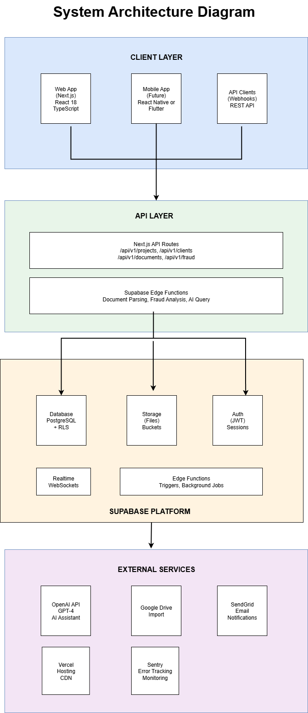

<p align="center">
  
</p>

<h1 align="center">FixDoc — Multi-Tenant Document Verification SaaS</h1>

[](#)
[](https://nextjs.org/)
[](https://react.dev/)
[](https://www.typescriptlang.org/)
[](https://tailwindcss.com/)
[](https://supabase.com/)
[](https://stripe.com/)
[](https://openai.com/)
[](#)
[](LICENSE)

---

> **This is a product showcase repository.** It contains documentation, architecture, and feature overviews for FixDoc, a proprietary multi-tenant SaaS platform developed by [ByteUp LLC](https://byteup.co). The source code is not included and the live application is not publicly accessible. For demos or licensing inquiries, see [Licensing](#licensing) below.

## About

**FixDoc** is a document-centric SaaS platform that enables mortgage officers and insurance agents to manage loan and policy applications, collect client documents, and leverage AI-powered fraud detection and decision-making assistance.

Built as a true multi-tenant system from day one — every row in every table is isolated by organization through PostgreSQL Row Level Security, every API request is validated against a 6-role RBAC matrix, and every subscription tier is enforced at the database layer, not the UI.

Currently in active development at **v0.11.0 (Polish & Beta-Ready)**, progressing toward v1.0.0 production release.

## Key Features

### Multi-Tenant Platform Core

- **Organization isolation** — Every table protected by PostgreSQL Row Level Security (RLS)
- **6-role RBAC system** — `super_admin`, `org_owner`, `org_admin`, `org_officer`, `org_agent`, `org_viewer` with 35+ permissions
- **Team management** — Member invitations, onboarding flows, per-organization role assignment
- **Organization-scoped storage** — Supabase Storage buckets with RLS-backed access control
- **Audit logging** — Every mutation tracked with actor, target, timestamp, and previous/new state for compliance

### CRM & Client Management

- Full client profiles — contacts, addresses, employment history, asset records
- Standardized pagination and filtering across all list endpoints
- Full-text search on client data
- Relationship tracking between clients and projects

### Project & Application Workflow

- Loan and insurance application management with status workflow
- Team assignments — multiple officers/agents per project
- Client-project linking with sub-relationship metadata
- Project-level statistics and reporting

### Document Management

- Upload, version, and organize documents by type
- Supabase Storage with signed URL downloads (1-hour expiry)
- 50 MB file size limit per upload
- Document version history with full audit trail
- Document type registry for standardized collection

### AI Fraud Detection Engine

The fraud engine is FixDoc's differentiator. It parses uploaded pay stubs and bank statements, then runs a multi-stage analysis:

- **Document parsing** — `pdf-parse` extracts text from PDFs, GPT-4o structures the data
- **Cross-checking** — Deposits on bank statements are validated against income declared on pay stubs
- **Identity verification** — Document holder matched against the linked client record
- **Risk scoring** — 0–100 score with configurable score floors and evidence-level confidence badges
- **Direction-aware income analysis** — Detects discrepancies in both directions (over-stated and under-stated)
- **Checks-performed tracking** — Full audit of which validations ran on which documents
- **Evidence detail UI** — Drill-down panel showing exactly which data points triggered each flag

### AI Assistant

- Chat interface scoped to a single project
- Context-aware — the assistant reads project files, CRM data, and document contents
- Conversation history with user feedback capture
- OpenAI GPT-4o backend

### Billing & Subscriptions (Stripe)

- 4 subscription tiers with plan-specific feature gates
- Stripe Checkout, Customer Portal, and webhook integration
- Usage tracking (documents processed, fraud analyses run, AI assistant messages)
- Invoice history and refund management
- **Plan limit enforcement at the database layer** via triggers, not just the UI
- **Graceful upgrade prompts** — plan limits show modals guiding users to upgrade, not hard errors

### Notifications

- Real-time in-app notifications for document uploads, fraud analysis completion, team activity
- Email notifications via Resend with 6 brand-aligned templates
- Digest options: instant, daily, weekly
- Quiet hours, per-type preferences, CAN-SPAM-compliant unsubscribe
- Vercel Cron for digest delivery

### Performance & Reliability

- **In-memory LRU cache** for plan limits, usage data, and completed fraud analyses
- **Per-org rate limiting** with plan-tier-aware sliding window
- **Batched dashboard queries** to minimize round trips
- **Singleton admin Supabase client** to prevent connection pool exhaustion
- **Deferred providers** for lazy-loading non-critical UI context

## Architecture

<p align="center">
  
</p>

FixDoc follows a four-layer architecture: client applications call Next.js API routes, which interact with the Supabase platform (PostgreSQL, Storage, Auth, Realtime), backed by external services for AI, payments, and email.

```
+-------------------------------------------------------------+
|                      CLIENT LAYER                           |
|   Web App (Next.js 16)  |  Mobile (Future)  |  API Clients |
+-------------------------------------------------------------+
                              |
                              v
+-------------------------------------------------------------+
|                       API LAYER                             |
|            Next.js API Routes (110+ endpoints)              |
+-------------------------------------------------------------+
                              |
                              v
+-------------------------------------------------------------+
|                   SUPABASE PLATFORM                         |
|   Database (PostgreSQL)  |  Storage  |  Auth  |  Realtime   |
+-------------------------------------------------------------+
                              |
                              v
+-------------------------------------------------------------+
|                   EXTERNAL SERVICES                         |
|          OpenAI GPT-4o  |  Stripe  |  Resend  |  Vercel    |
+-------------------------------------------------------------+
```

### Domain Overview

<p align="center">
  
</p>

FixDoc is organized into 8 bounded domains: **Platform Core** (users, organizations, sessions), **CRM** (clients, contacts, addresses, employments, assets), **Projects** (applications, assignments, status workflows), **Documents** (uploads, versions, types), **Fraud Analysis** (runs, evidence, checks), **Billing** (subscriptions, invoices, usage), **Communication & AI** (notifications, assistant conversations), and **Integration** (external service sync). Each domain has its own detailed ERD with column-level schema — available under NDA for licensing or pilot discussions.

### Why this stack

- **Next.js 16 (App Router)** — Server components keep the client bundle small, API routes live next to pages, edge functions available for low-latency endpoints
- **Supabase (Postgres + RLS)** — Multi-tenancy at the database layer, not the application layer. Even if an API route is compromised, RLS prevents cross-tenant data leaks.
- **Stripe** — Subscription billing, webhooks, customer portal, and plan metadata all live in Stripe. The app never calculates what a plan costs.
- **OpenAI GPT-4o** — Structured output mode for document parsing (predictable JSON), vision-capable for scanned PDFs, cost-effective at production volume
- **Resend** — Clean API, React Email template support, unsubscribe webhook out of the box

## Tech Stack

| Layer           | Technology                                              |
| --------------- | ------------------------------------------------------- |
| Frontend        | Next.js 16, React 19, TypeScript 5, Tailwind CSS v4     |
| UI Library      | TailAdmin Pro (dashboard components)                    |
| Backend         | Next.js API Routes (110+ endpoints), Edge Functions     |
| Database        | PostgreSQL (Supabase) with Row Level Security           |
| Auth            | Supabase Auth (JWT, refresh tokens, OAuth-ready)        |
| Storage         | Supabase Storage (org-scoped buckets, 50 MB limit)      |
| Payments        | Stripe Checkout, Customer Portal, Webhooks              |
| AI              | OpenAI GPT-4o (document parsing, fraud detection)       |
| PDF Parsing     | `pdf-parse` (text extraction)                           |
| Email           | Resend (transactional + digest)                         |
| Validation      | Zod (schemas for every API endpoint)                    |
| Testing         | Vitest (unit), custom (integration + E2E + load)        |
| CI/CD           | GitHub Actions                                          |
| Hosting         | Vercel (serverless + edge)                              |
| Monitoring      | Error tracking + performance monitoring                 |

## Engineering Highlights

### Multi-Tenancy Done Right

Multi-tenancy in FixDoc is enforced at three layers:

1. **Database (RLS)** — Every table has a Row Level Security policy keyed to `organization_id`. Even if a bug in the application code were to try to query another org's data, PostgreSQL returns zero rows.
2. **API (middleware)** — Every request is authenticated and the user's `org_id` is injected into every query. Routes never trust `org_id` from the URL or body — it's derived from the JWT.
3. **UI (RBAC gating)** — Every page and component checks the current user's role via a `useUserRole()` hook. Unauthorized elements are not rendered, not just disabled.

**Result:** Cross-tenant data leaks are architecturally impossible, not just blocked by application code.

### Fraud Engine Design

The fraud engine runs as a dedicated service layer, decoupled from API routes, implementing a multi-stage AI pipeline: structured extraction from source documents, cross-validation against client records, weighted risk scoring (0–100) with configurable thresholds and direction-aware analysis, and evidence-level detail for UI drill-down. Every check performed is logged for compliance audit.

Results are cached to prevent redundant reruns during UI interactions, and stored with enough evidence for compliance reviewers to see exactly what validations ran on which documents.

*Implementation details, service interfaces, and the full fraud validation logic are available under NDA for pilot discussions or licensing inquiries.*

### Caching & Rate Limiting

Plan limits, usage counters, and completed fraud analyses are cached in an in-memory LRU cache — zero-dependency, no Redis required. The cache is keyed by `org_id + resource` and invalidated on mutations.

Rate limiting uses a sliding window keyed by org, with window sizes that scale with subscription tier. Higher plans get higher burst allowances without changing route code.

### Stripe Webhook Handling

Inbound Stripe webhooks are verified against `STRIPE_WEBHOOK_SECRET`, then processed idempotently — duplicate events are detected by Stripe's `event.id` and skipped. A single webhook endpoint handles 8+ event types (subscription created, updated, canceled, invoice paid, refunded, etc.) through a dispatcher pattern.

### Document Security

- Documents stored in **org-scoped Supabase buckets** with RLS policies
- Downloads served via **signed URLs** with 1-hour expiry — no permanent public URLs
- File size capped at **50 MB** enforced at upload
- Document types validated against a registry before storage

## By the Numbers

| Metric                    | Value                                      |
| ------------------------- | ------------------------------------------ |
| API Endpoints             | 110+ across 13 domains                     |
| Database Tables           | 40+                                        |
| Database Migrations       | 14 versioned SQL files                     |
| RBAC Roles                | 6                                          |
| RBAC Permissions          | 35+                                        |
| Subscription Tiers        | 4                                          |
| Fraud Engine Checks       | 10+ validation types                       |
| Email Templates           | 6 transactional + digest                   |
| Total Tests               | **1,000+** (699 unit, 249 integration, 57 E2E) |
| Release Documents         | 15 versioned release specs (v0.1.0 → v1.0.0) |

## Roadmap

Versioned release plan from v0.1.0 through v1.0.0, each with its own detailed scope document.

| Phase    | Versions        | Focus                          | Status       |
| -------- | --------------- | ------------------------------ | ------------ |
| Phase 0  | v0.1.0 – v0.3.0 | Platform Foundation            | Complete     |
| Phase 1  | v0.4.0 – v0.9.0 | Core Features (MVP)            | Complete     |
| Phase 2  | v0.10.0 – v1.0.0 | Production Release             | In Progress |
| Phase 3  | v1.1.0+         | Enhancements                   | Pending      |
| Phase 4  | v2.0.0          | Insurance Expansion            | Pending      |

### Version progress

| Version  | Name                         | Status      |
| -------- | ---------------------------- | ----------- |
| v0.1.0   | Authentication               | Complete    |
| v0.2.0   | Organizations                | Complete    |
| v0.3.0   | Admin Panels                 | Complete    |
| v0.4.0   | CRM                          | Complete    |
| v0.4.5   | Billing & Subscriptions      | Complete    |
| v0.5.0   | Projects                     | Complete    |
| v0.6.0   | Documents                    | Complete    |
| v0.7.0   | Fraud Engine                 | Complete    |
| v0.8.0   | AI Assistant                 | Complete    |
| v0.9.0   | Real-Time & Notifications    | Complete    |
| v0.10.0  | Internal Notes               | Complete    |
| v0.11.0  | Polish & Beta-Ready          | Complete    |
| v0.12.0  | Testing, Docs & Pre-Beta     | In Progress |

## Security Posture

### Authentication

- JWT-based authentication via Supabase Auth
- Access tokens expire in 1 hour
- Refresh tokens expire in 7 days
- Failed login lockout after 5 attempts
- OAuth-ready architecture (Google provider planned)

### Authorization

- Role-Based Access Control (RBAC) with **6 roles and 35+ permissions**
- Row Level Security (RLS) on every table
- Organization-scoped data isolation at the database layer
- Permission checks in both API middleware and UI
- Subscription-tier feature gating

### Data Protection

- TLS 1.3 for data in transit
- AES-256 encryption for data at rest
- Organization-scoped storage buckets
- Signed URLs for document downloads (1-hour expiry)
- Audit logging for every mutation (actor, target, state diff, timestamp)

### API Security

- Every endpoint validates inputs with Zod schemas
- Rate limiting per organization with plan-tier scaling
- Stripe webhooks verified against signing secret before processing
- Consistent error responses with error codes — no leaked stack traces

## CI/CD Pipeline

GitHub Actions pipeline (`.github/workflows/ci.yml`) with 5 stages:

1. **Quality** — ESLint, TypeScript strict mode check
2. **Unit Tests** — 699+ Vitest tests
3. **Build** — Next.js production build
4. **Integration** — 249 API endpoint tests against a live dev server
5. **Load** — Performance tests (main branch only)

All stages must pass before merge to `main`.

## Documentation Structure

FixDoc ships with extensive documentation — not as an afterthought, but as a deliverable.

| Document                                | Purpose                                                    |
| --------------------------------------- | ---------------------------------------------------------- |
| `ROADMAP.md`                            | Version-by-version development plan                        |
| `product_requirements_document.md`      | Product vision, features, user stories                    |
| `technical_standards.md`                | NFRs, SLOs, security requirements, coding standards        |
| `frontend_technical_standards.md`       | Frontend patterns, testing conventions, component rules    |
| `entity_analysis.md`                    | Full database schema documentation                         |
| `rbac_permissions_matrix.md`            | Role-based access control matrix                           |
| `rls_policies.md`                       | Row Level Security policy documentation                    |
| `releases/v0.1.0.md` – `v1.0.0.md`      | Per-version scope, acceptance criteria, deliverables      |
| `api/postman/`                          | Postman collection for all 110+ endpoints                 |
| `diagrams/`                             | ERDs (9 diagrams) and architecture diagrams               |
| `wireframes/`                           | UI wireframes                                             |

## Skills Demonstrated

| Area                     | Details                                                                          |
| ------------------------ | -------------------------------------------------------------------------------- |
| Multi-Tenant SaaS        | RLS, org-scoping, cross-tenant isolation at database layer                       |
| Full-Stack TypeScript    | Next.js 16 App Router, React 19, strict TS, 110+ API routes                     |
| Database Design          | 40+ tables, 14 migrations, FK integrity, indexing, RLS policies                 |
| RBAC                     | 6-role matrix with 35+ permissions, API + UI enforcement                        |
| Payments Integration     | Stripe Checkout, Customer Portal, webhook dispatching, plan-tier enforcement    |
| AI/ML Integration        | GPT-4o document parsing, fraud scoring, context-aware AI assistant             |
| Security                 | RLS, RBAC, signature verification, audit logging, signed URLs                  |
| Performance              | LRU caching, rate limiting, batched queries, singleton patterns                |
| Testing                  | 1,000+ tests across unit, integration, E2E, load                                |
| DevOps                   | GitHub Actions CI, 5-stage pipeline, Vercel deployment                         |
| Documentation            | 15 release specs, NFRs, ERDs, Postman collection, wireframes                   |

## About ByteUp

FixDoc is a product of **[ByteUp LLC](https://byteup.co)**, a software studio building SaaS products for underserved markets and delivering contract development for clients who value clean architecture and reliable code.

### ByteUp products

| Product                   | Status             | Link                                                                                        |
| ------------------------- | ------------------ | ------------------------------------------------------------------------------------------- |
| **FixDoc**                | Active development | You are here                                                                                |
| **Migratex**              | Production-ready   | [migratex-showcase](https://github.com/ivansing/migratex-showcase) — Excel → PostgreSQL ETL CLI |
| **Stripe Payment Links**  | Production-ready   | [stripe-payment-links-showcase](https://github.com/ivansing/stripe-payment-links-showcase) — FastAPI payment API |
| **TroveTrends**           | Live               | [trovetrends.com](https://trovetrends.com)                                                  |

### Author

Built and maintained by **Ivan Duarte**, Full-Stack Software Engineer and founder of ByteUp LLC. Based in Bogotá, Colombia.

- Company: [byteup.co](https://byteup.co) · contact@byteup.co
- GitHub: [@ivansing](https://github.com/ivansing)
- LinkedIn: [lance-dev](https://linkedin.com/in/lance-dev)

## Licensing

FixDoc is proprietary software developed by ByteUp LLC. The source code is not included in this repository and is not available under any open-source license. The live application is not publicly accessible.

This repository contains documentation and marketing materials only. The content (README, architecture documentation, feature overviews) is provided for informational and portfolio purposes.

**For product demos, pilot access, or commercial licensing inquiries, contact contact@byteup.co.**

---

*Document Version: 1.0 · Product: FixDoc · Status: Active Development · Launching at fixdoc.co*
